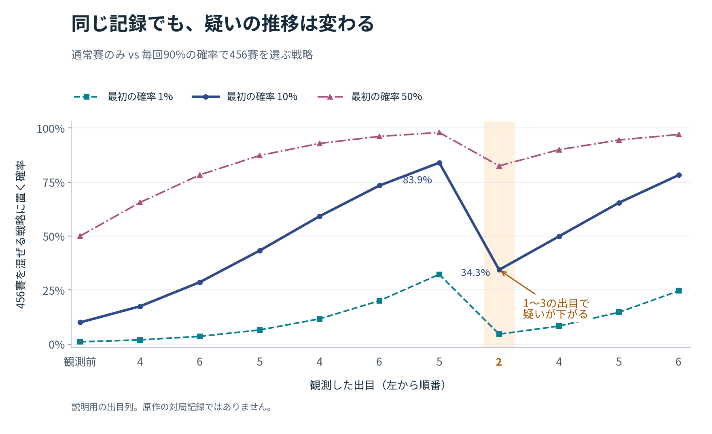

「くだらないこと」を、真剣に考える。フィクションの世界を現実の科学で考えてみる話には、つい読みふけってしまう面白さがあります。

例えば、ガンダムシリーズのスペースコロニーやAMBACです。巨大なコロニーを回転させて人工重力を作るなら、その構造や材料にはどのくらいの強度が必要なのか。手足の動きで宇宙空間の機体の姿勢を変えるAMBACは、どんな仕組みで、どこまでできるのか。そんな考察を読むのが好きです。

ただし、サイコフレームの共振とか、オーラ力で解決するのは、今回はなしで。

そんな調子で、今回はベイズ推定を使って、身近なフィクションを考えてみることにしました。題材に選んだのは、『賭博破戒録カイジ』の地下チンチロ編です。

地下チンチロは、勝率のシミュレーションやベイズ推定について、すでに公開の考察もある題材です。[^related]

サイコロの出目なら、まずは「1〜3が出た／4〜6が出た」という単純な二値の記録から始められます。そこから、勝敗や賭け金、どの局面でどのサイコロを使うかまで、少しずつ条件を増やして考えられる。使い方や条件を変えたら結果がどう変わるのか、という因果推論の問いまで考える入口にもなりそうです。

その中でも気になったのが、三好の記録と、カイジの違和感のつながりでした。

全体を眺めると、よく勝つ相手に見える。けれど、記録の中の「ここ一番」に注目すると、何かが違う。その違和感を、記録と確率の言葉で考えられないだろうか。

そこで、最初はサイコロ1個にまで単純化して、ベイズ推定で計算してみました。

すると、最初にどのくらい疑っているかで確率の推移が変わること、途中の出目で疑いが大きく下がること、さらには「いつ、どんな場面だったか」で記録の意味も変わることが見えてきました。

このシリーズでは、その過程を単純なモデルから順番に紹介します。第0回となる今回は、問いと全体像の案内です。数式の導出は次回以降に回し、詳しい資料へのリンクも末尾にまとめました。

※ 地下チンチロ編の仕掛けに触れます。以下の計算は作品から着想を得たモデルによるもので、原作の全対局をデータ化したものではありません。

## 三好が残したものと、カイジが見たもの

地下チンチロの仕掛けに登場するのが、4・5・6の目しか出ない「456賽」です。通常のサイコロより強い役が出やすくなります。

ただ、相手がずっと勝ち続けているならともかく、ときどき負けることもある。通常の勝負を交えながら、肝心なところで利益を積み重ねていたら、単に「強いなあ」と見てしまうかもしれません。

そこで気になるのが、勝敗だけでなく、賭け金や出目を対応させて見ることです。

「何回勝ったか」に加えて、「どんな場面で、どんな出目だったか」を見る。三好の記録があれば、その関係を振り返れます。そして、記録のどこに注目するかによって、考えられる説明も変わります。

このシリーズでは、三好の役割を**情報を残すこと**、カイジの着眼点を**その記録を説明する仮説を考えること**として捉えてみます。

もちろん、カイジが頭の中でベイズ計算をしていた、という話ではありません。作品をきっかけに生まれた問いを、こちらでモデルにして確かめてみよう、という試みです。

## まずはサイコロ1個から始める

いきなりチンチロ全体を扱うと、3個のサイコロ、役の強さ、振り直し、賭け金など、考えることが多くなります。

そこで最初は、サイコロ1個の出目を、次の二つにまとめます。

- **1〜3が出た**
- **4〜6が出た**

通常のサイコロなら、どちらも確率は半分。456賽なら、必ず4〜6が出ます。まずは、この二値の観測を繰り返す二項モデルを出発点にします。

ただし、通常のサイコロでも4〜6は出ます。1回出ただけでは区別できません。では、何回も続いたらどうでしょうか。

ここでベイズ推定を使い、「通常賽だけを使う」と「456賽を使う戦略を取る」という二つの説明を比べます。

この記事でいう**「疑いの確率」は、この二つを比較したときに、後者の仮説に置く確率**です。比較する仮説や最初の確率を決めたうえで計算するもので、人間が実際に違和感を覚える心理を測った値ではありません。

## 同じ記録でも、疑いの推移は変わる

計算の雰囲気が分かる例を、一つ見てみます。

比較する仮説を、次のように置きます。

- **通常賽だけを使う**：毎回、1〜6が等確率で出る。
- **456賽を混ぜて使う**：毎回独立に、90%の確率で456賽、10%の確率で通常賽を選ぶ。

後者でも通常賽を使うことがあるため、1〜3が出る可能性は残っています。

この設定で、同じ出目列を観測したときの「456賽を混ぜる戦略に置く確率」を描いたのが、次の図です。最初の確率だけを1%・10%・50%と変えています。

*説明用の出目列「4, 6, 5, 4, 6, 5, 2, 4, 5, 6」による例。図の出発点と456賽の使用率は説明のための仮定で、原作から求めた値ではありません。*

同じ記録でも、最初に置く確率によって曲線は違います。この出発点が「事前確率」です。

一方、どの曲線でも、4〜6が続くと疑いは上がり、途中で2が出ると下がっています。最初が10%の線では、6回目までに約84%へ上がったあと、2を見て約34%へ下がります。

それまで6回、4〜6が続いていたのに、1回の観測で大きく変わる。このモデルでは、疑いを強める出目と弱める出目の効き方は、対称ではありません。

また、この図で見ているのは**サイコロ1個の出目**です。4〜6を「勝ち」、1〜3を「負け」としているわけではありません。実際の勝敗を考えるには、もう少しモデルを広げる必要があります。

この図の計算方法と、事前確率をどう読むかは、第2〜3回で扱います。

## イカサマをしていても、負けることはある

456賽は強い役を出しやすいサイコロですが、必ず勝てるわけではありません。相手がさらに強い役を出せば負けます。

そのため、「負けたから、その手番は通常賽だった」とは言えません。

勝敗だけを記録した場合と、本人や相手の出目まで記録した場合でも、使える情報は違います。同じ1敗でも、何を観測しているかによって、その意味を考える必要があります。

ここから、サイコロ3個を一式で使うこと、役ができるまで振り直すこと、相手の役と比較することへ、モデルを少しずつ広げていきます。

単純なモデルを作って終わるのではなく、「これでは扱えていない部分は何か」を確かめながら進めます。

## 「ここ一番」を見ると、何が変わるのか

さらに、相手の使い方を考えてみます。

「いつでも一定の割合で456賽を使う」という戦略と、「普段は通常賽を使い、勝負どころで456賽を使う」という戦略では、予測する出目が違います。

後者なら、普段の場面で普通の出目が出ても不思議ではありません。通常時には通常賽を使う仮説なのですから、その場面で1〜3が出ても、仮説への疑いが下がらない場合があります。

先ほどの図では1〜3が出ると疑いが下がりましたが、想定する戦略が変わると、同じ出目の意味も変わるわけです。

三好の記録とカイジの着眼点を、確率の話として考える面白さは、ここにあると思います。記録の量だけでなく、**いつの記録なのか、何を比較しているのか**が効いてきます。

ただし、「勝負どころ」は、賭け金など出目を見る前に分かる条件で区切ります。結果を見てから勝った場面だけを拾えば、別の話になってしまいます。記録から新しい説明を思いついたなら、その後の記録でも説明が通るかを確かめたいところです。

この話には、第5回で戻ってきます。

## このシリーズで、順番に考えること

各回に一つずつ問いを置き、必要になったところで考え方や計算を紹介する予定です。

| 回 | テーマ | 中心となる問い |
| --- | --- | --- |
| 第0回・この記事 | 三好の記録とカイジの違和感 | 地下チンチロから、何を考えてみたのか |
| 第1回 | なぜベイズ推定で考えるのか | ベイズ統計・推定・更新はどうつながり、なぜ今回使うのか |
| 第2回 | 同じ出目でも、疑い方は変わる | 観測を重ねるとどう変わり、事前確率はどう効くのか |
| 第3回 | 通常のサイコロを混ぜたら？ | 疑いが上がる出目と、下がる出目はどう違うのか |
| 第4回 | 456賽でも負ける | 出目と勝敗では、得られる情報がどう違うのか |
| 第5回 | 全体ではなく、勝負どころを見る | 局面で使い分ける戦略を、記録からどう考えるか |
| 第6回 | 「99%怪しい」は、どこまで確かなのか | 仮説の確率と、誤って疑う頻度はどう違うのか |
| 第7回 | 記録から分かること、分からないこと | 仮定に依存する推定を、その後の観測でどう確かめるか |

第1回は、台風の進路予測のような身近な例から、推定と予測、ベイズ統計とベイズ推定の関係を整理します。ベイズ推定以外の方法にも触れながら、今回この道具を選ぶ理由を説明します。

必要な式は紹介しますが、まずは「何が知りたくて、何を計算しているのか」を追える記事にしたいと思っています。

出目から使い方を考える。この小さな例は、直接には確かめにくいものを、残された記録から考える場面にもつながるかもしれません。

## 詳しい資料・コード

シリーズの土台となる資料は、GitHubで公開しています。導出や検証を先に読みたい方は、こちらを参照してください。

- **[Letter：主要結果をまとめた4ページの資料](https://github.com/okamasaya/underground_ChinChiro_with_baysian/blob/main/kaiji_bayes_letter_20261105.pdf)**
  全体の問いと主要結果を短く確認できます。このシリーズの先にある検討も含んでいます。
- **[Full paper：モデル・導出・検証をまとめた68ページの資料](https://github.com/okamasaya/underground_ChinChiro_with_baysian/blob/main/kaiji_ungr_456dice.pdf)**
  賽の分布、ベイズ更新、役と勝敗、局面別の戦略、判定の誤警報などを詳しく扱っています。
- **[GitHubリポジトリ：コード・図版・保存した計算結果](https://github.com/okamasaya/underground_ChinChiro_with_baysian)**
  導入用のノートブックや、Pythonによる計算・作図コードを収録しています。実行方法は[再現手順](https://github.com/okamasaya/underground_ChinChiro_with_baysian/blob/main/docs/REPRODUCIBILITY.md)を参照してください。

各回では、話題に対応する資料の箇所やコードにも案内します。この記事の図を再生成するコードは、[こちら](https://github.com/okamasaya/underground_ChinChiro_with_baysian/blob/main/articles/assets/plot_chinchiro_overview.py)です。

物語の着想は、福本伸行『賭博破戒録カイジ』の地下チンチロ編によります。モデルの仮定と計算例は、原作の設定や実対局の記録とは区別しています。

[^related]: 例えば、mike_neck「[カイジの地下チンチロで班長大槻が勝つ確率をシミュレートするGroovyスクリプト](https://mike-neck.hatenadiary.com/entry/2014/10/14/041617)」（2014年）、nemurukame「[Bayesian（ベイジアン）とFrequentist（頻度論者）の立場からカイジ『地下チンチロ』に登場した四五六賽を研究する](https://nemurukameblog.com/2020/05/05/research-report/)」（2020年）。Full paperの参考文献にも記載しています。
