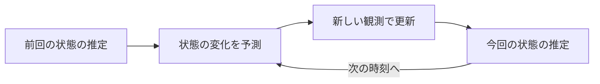

台風が近づくと、予測進路を何度も確認してしまいます。

「昨日より東に寄ったな」「このまま進むと、週末の予定はどうなるだろう」。ウェザーニュースなどで進路予測を見ていると、更新のたびに気になります。数値予報やAIによる予測という言葉を見かけることもあります。

まだ起きていないことを、どうやって予測するのか。そして、新しい情報が入ったら、見通しをどう変えるのか。

前回は、フィクションを真剣に考える題材として、カイジの地下チンチロを紹介しました。今回は少し寄り道して、身近な予測から「分からないことを、記録から考える」ための道具を整理します。

ベイズ推定を選んだ理由と、観測するたびに考えを更新する仕組みまで、一つの小さな計算で見てみます。

シリーズの全体像は、[第0回「三好の記録とカイジの違和感」](https://github.com/okamasaya/underground_ChinChiro_with_baysian/blob/main/articles/chinchiro-bayes-00-overview.md)にまとめています。

## 台風の進路を予測する前に、現在を知りたい

台風の将来の進路を考えるには、出発点となる現在の大気の状態が必要です。しかし、地球上のあらゆる場所で、風や気温などを隙間なく正確に測れるわけではありません。

限られた観測やモデルを使って、現在の状態を考える。その状態を出発点に、将来の変化を計算する。新しい観測が届けば、また見直す。[^weather]

ここには、二つの問いがあります。

- **いま、どんな状態なのか。**
- **その状態から、次に何が起こりそうか。**

この記事では、分からない状態や仕組みを観測から考えることを「推定」、将来の観測や出来事について考えることを「予測」と呼びます。推定する対象は、現在だけでなく過去の状態や、時間によらないパラメータの場合もあります。

両者はつながっていますが、同じ言葉ではありません。現在の台風の位置や周囲の風を推定することと、明日の台風の位置を予測することでは、知りたい対象が違います。

なお、数値予報やAI予測という分類と、ベイズ統計という枠組みは別の話です。台風予測がすべて、これから説明するベイズ計算だけで行われているという意味ではありません。ここでは、推定と予測の関係を考えるための例として使っています。

## ベイズ統計・ベイズ推定・ベイズ更新

「ベイズ」という言葉にも、いくつかの使い方があります。このシリーズでは、次のように整理します。

| 言葉 | この記事での意味 |
| --- | --- |
| ベイズ統計 | 未知のものについての不確かさを確率で表し、事前の情報と観測を組み合わせて、推定・予測・モデル比較などを行う枠組み |
| ベイズ推定 | その枠組みを使い、未知のパラメータや状態などについて、観測後の分布を求めること |
| ベイズ更新 | 新しい観測を得たときに、その分布を更新する操作 |

地下チンチロで知りたいのは、「どんなサイコロを、どんな戦略で使っているのか」です。出目は見えても、使っているサイコロの種類や使い分けは、そのまま見えるとは限りません。

そこで、「通常賽だけを使う」「456賽を混ぜて使う」といった説明を候補に置き、観測に応じて、それぞれに置く確率を更新していきます。今回の中心は、この**仮説の比較と更新**です。

サイコロの偏りという数値を推定する問題と、二つの戦略仮説を比較する問題は区別します。どちらもベイズの枠組みで扱えますが、何を未知としているかが違います。

## 他にも方法はあるのに、なぜベイズ推定なのか

サイコロを調べる方法は、ベイズ推定だけではありません。

例えば、「4〜6が出る割合」を推定するなら、観測した割合を使う方法があります。二項モデルでは、それは最尤推定にもなります。

「通常賽だとしたら、これほど4〜6に偏るのは珍しいのか」を調べるなら、二項検定も考えられます。ただし、その珍しさを示すp値は、そのまま「通常賽である確率」にはなりません。

今回、気になったのは、次のようなことでした。

- 最初はほとんど疑っていなくても、出目を見続けたらどう変わるのか。
- 疑いを強める出目と弱める出目が混ざったら、どうなるのか。
- 通常賽も使う相手や、勝負どころで使い分ける相手を、どう考えるのか。

これらを、**比較する仮説・最初に置く確率・各仮説での出目の出やすさ**に分けて書けるのが、今回ベイズの枠組みを選んだ理由です。

逐次的にデータを扱えること自体は、ベイズ推定だけの特徴ではありません。今回の「記録を見ながら、ある戦略への疑いがどう変わるか」という問いと、計算の形がよく対応している、という選択です。

## まずは、一度だけ計算してみる

サイコロ1個を振り、「4〜6が出た」という観測を考えます。

ここだけは説明を簡単にするため、比較する仮説を次の二つに絞ります。

- **通常賽を使い続ける。** 1〜6が等確率で出る。
- **456賽を使い続ける。** 4・5・6が等確率で出る。

第0回の図は「通常賽を混ぜる戦略」でしたが、この計算例では混ぜません。また、サイコロ1個の出目の話なので、4〜6が出ることを「勝ち」と呼んでいるわけではありません。

観測前に、「456賽を使い続ける」に10%、「通常賽を使い続ける」に90%を置くとします。これが**事前確率**です。10%は説明用に置いた値で、原作から測定した数字ではありません。

次に、それぞれの仮説で「4〜6が出る確率」を考えます。

通常賽なら半分なので50%。456賽なら必ず出るので100%です。**その仮説の下で、今回の観測がどれくらい出やすいか**を表すのが、ここでの尤度です。

事前確率と尤度を掛けると、次のようになります。

| 仮説 | 事前確率 | 4〜6が出る確率 | 掛け合わせた重み |
| --- | ---: | ---: | ---: |
| 通常賽を使い続ける | 0.90 | 0.50 | 0.45 |
| 456賽を使い続ける | 0.10 | 1.00 | 0.10 |

この重みを、合計が1になるように割り直します。

$$
\frac{0.10}{0.45+0.10} \simeq 18.2\%
$$

「456賽を使い続ける」に置く確率は、10%から約18.2%になりました。これが、今回の観測を得た後の**事後確率**です。

4〜6は456賽なら必ず出ますが、通常賽でも半分は出ます。だから、1回見ただけで456賽だと確定するわけではありません。

**「456賽なら4〜6が出る確率」と、「4〜6を見た後に456賽という仮説に置く確率」は違う。** この向きの違いが、計算して確かめたいところです。

## 推定したものを、次の予測に使う

ここで、次の1回で4〜6が出る確率も考えてみます。

通常賽という仮説には残りの約81.8%が置かれていて、通常賽でも4〜6は半分の確率で出ます。456賽という仮説には約18.2%が置かれていて、こちらなら必ず4〜6が出ます。

通常賽の分の「約81.8% × 50%」と、456賽の分の「約18.2% × 100%」を足し合わせると、次に4〜6が出る確率は約59.1%になります。

同じ観測から得た数字でも、意味は違います。

- **約18.2%**：456賽を使い続けるという仮説に置く確率。
- **約59.1%**：次の1回で4〜6が出ると予測する確率。

どちらも、いま置いている二つの仮説と事前確率の下での値です。推定した仮説についての不確かさを残したまま、次の観測を予測できます。

その次の出目を見たら、約18.2%となった仮説確率を出発点にして、もう一度更新します。**前回の事後確率を、次の観測に対する事前確率として使う**わけです。

このとき、すでに使った出目を、新しい証拠としてもう一度数えてはいけません。次の更新に使うのは、新しく得られた観測です。

また、「常に456賽」という今回の仮説では、1〜3が出る確率は0です。それを観測すれば、この仮説への確率は0になります。通常賽を混ぜる戦略まで否定したことにはならないので、そこは第3回でモデルを広げます。

## 状態が変わるなら、予測する段階が加わる

ここまで比較したのは、「同じ種類のサイコロを使い続ける」という固定した仮説でした。

一方、台風の位置や移動する物体の位置は、時間とともに変わります。前の時刻に推定した位置を、そのまま次の時刻の位置として使うことはできません。

この場合は、まず状態がどう変わるかを予測し、新しい観測を使って更新します。こうして、順次得られる観測から、その時点の状態を推定するのが**ベイズフィルタリング**です。[^filtering]

ここで登場するのが、カルマンフィルタや粒子フィルタです。

**カルマンフィルタ**は、状態の変化や観測の関係が線形で、初期状態や雑音が正規分布に従う条件の下で、分布の平均と共分散を使って、この予測と更新を解析的に計算できます。

**粒子フィルタ**は、候補となる状態を多数の粒子と重みで表し、分布を近似します。非線形の関係や、正規分布では表しにくい分布も扱えますが、粒子数や計算量、近似の精度を考える必要があります。

カルマンフィルタの次に粒子フィルタへ進めば、いつでもよくなる、という関係ではありません。対象に合うモデルと、実行できる計算を選びます。

このシリーズではアルゴリズムの詳細には踏み込みませんが、**ベイズの考え方を保ちながら、対象に合わせてモデルや計算方法を変えられる**という見通しは、持っておきたいところです。

## 次回は、出目を重ねてみる

今回は1回だけ更新しました。では、4〜6が続いたら、疑いはどこまで上がるのでしょうか。最初に置く確率が10%ではなく1%だったら、同じ記録でもどう変わるのでしょうか。

第2回は、サイコロ1個の単純なモデルで更新を繰り返し、事前確率によって曲線がどう変わるかを見ていきます。

## 詳しい資料・コード

- **[Letter：主要結果をまとめた4ページの資料](https://github.com/okamasaya/underground_ChinChiro_with_baysian/blob/main/kaiji_bayes_letter_20261105.pdf)**
  全体の問いと主要結果を確認できます。
- **[Full paper：モデル・導出・検証をまとめた68ページの資料](https://github.com/okamasaya/underground_ChinChiro_with_baysian/blob/main/kaiji_ungr_456dice.pdf)**
  今回の計算は、第3節「逐次ベイズ更新の導出」、特に「純粋モデルの閉形式と数値例」に対応します。第2節では二項モデルと検定も扱っています。
- **[導入用ノートブック](https://github.com/okamasaya/underground_ChinChiro_with_baysian/blob/main/Bayesian_updating_456dice.ipynb)**
  単一賽のベイズ更新などを計算しています。純粋モデルと混合モデルの設定を区別して参照してください。
- **[GitHubリポジトリ](https://github.com/okamasaya/underground_ChinChiro_with_baysian)**
  計算コード、図版、保存データを収録しています。実行方法は[再現手順](https://github.com/okamasaya/underground_ChinChiro_with_baysian/blob/main/docs/REPRODUCIBILITY.md)にまとめています。

物語の着想は、福本伸行『賭博破戒録カイジ』の地下チンチロ編によります。仮説・事前確率・出目の分布は説明のための設定で、原作の対局や登場人物の心理を数値的に再現したものではありません。

[^weather]: 数値予報の基礎については、気象庁の[数値予報の解説](https://www.jma.go.jp/jma/kishou/know/whitep/1-3-1.html)を参照してください。この記事では、個別の予測サービスの方式や精度を比較していません。
[^filtering]: フィルタリングの体系的な説明として、Simo Särkkä, *Bayesian Filtering and Smoothing*, Cambridge University Press, 2013（[書籍のDOI](https://doi.org/10.1017/CBO9781139344203)）。カルマンフィルタ・粒子フィルタの紹介は、賽の計算から先への見通しとして補足しています。
