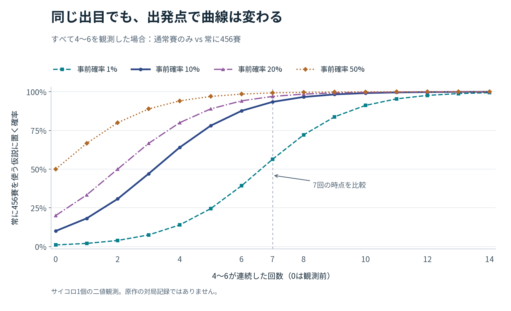

サイコロを振ったら、4・5・6ばかりが出る。

1回なら、普通のサイコロでもよくあることです。それが3回、5回、7回と続くと、だんだん気になってきます。

では、7回続いた時点で、「イカサマなのでは？」という疑いは、どのくらいになるのでしょうか。

今回のモデルでは、同じ7回の記録でも、最初に置く確率が1%なら約56%、50%なら約99%になります。

差を生むのが、観測前の出発点となる**事前確率**です。同じ記録を見ているのに、なぜここまで違うのか。今回は、出目を重ねたときの更新を、図と計算で追ってみます。

[第1回](https://github.com/okamasaya/underground_ChinChiro_with_baysian/blob/main/articles/chinchiro-bayes-01-why-bayes.md)では、仮説に置く確率と出目の出やすさを掛け合わせ、合計が1になるように割り直しました。未読でも、ここから同じ計算を追えるようにします。[シリーズの全体像は第0回](https://github.com/okamasaya/underground_ChinChiro_with_baysian/blob/main/articles/chinchiro-bayes-00-overview.md)にあります。

## 今回は「常に使う」二つの仮説を比べる

まず、比べるものを決めておきます。

- **通常賽を使い続ける。** 1〜6が等確率で出る。
- **456賽を使い続ける。** 4・5・6が等確率で出る。

同じサイコロを使い続け、種類が決まっているとき、それぞれの出目は独立に出ると仮定します。使い分けや振り直しは、まだ扱いません。

サイコロは1個で、観測は「1〜3が出た／4〜6が出た」の二つにまとめます。4〜6が出ることを、チンチロの「勝ち」としているわけではありません。

例えば、観測する出目列は次のようなものです。

> 4 → 6 → 5 → 4 → 5 → 6 → 4

今回は、これを「4〜6が7回続いた」という記録として扱います。この二つの仮説では、4・5・6のどれが出ても、仮説を比較する証拠の倍率は同じです。

以下の出目列と事前確率は説明用の設定で、原作の対局から求めたものではありません。また、第0回の図は通常賽を混ぜる戦略でしたが、今回は第1回の手計算と同じ、混ぜないモデルです。

## 10%から始めて、更新を繰り返す

最初に「456賽を使い続ける」に10%、「通常賽を使い続ける」に90%を置きます。

4〜6が出る確率は、456賽なら100%、通常賽なら50%です。最初の1回を観測したら、次のように更新します。

$$
\frac{0.10\times1}{0.10\times1+0.90\times0.5}
\simeq18.2\%
$$

2回目も4〜6なら、今度は約18.2%を出発点にして同じ操作を行います。3回目も、直前の結果を出発点にします。

**前回の事後確率を、次の観測に対する事前確率として使う。** 新しい出目が一つ増えるたびに、これを繰り返します。

| 4〜6が続いた回数 | 「常に456賽」に置く確率 |
| ---: | ---: |
| 0回・観測前 | 10.0% |
| 1回 | 18.2% |
| 2回 | 30.8% |
| 3回 | 47.1% |
| 4回 | 64.0% |
| 7回 | 93.4% |
| 10回 | 99.1% |

表示は小数点以下1桁に丸めていますが、計算途中では丸めていません。

疑いは増えていますが、「1回につき何ポイント上がる」と決まっているわけではありません。出発点に応じて、確率の増え方も変わります。

## 出発点だけ変えて、同じ記録を見る

次に、事前確率を1%・10%・20%・50%と変えてみます。

出目はすべて4〜6。通常賽と456賽の出目の分布も同じです。変えるのは、観測前に各仮説へ置く確率だけです。



*通常賽のみと常に456賽という二つの仮説を比較した計算例。各曲線は、すべての観測が4〜6だった場合の推移です。*

7回の時点を取り出すと、こうなります。

| 「常に456賽」の事前確率 | 4〜6を7回観測した後 | 99%以上に初めて達する回数 |
| ---: | ---: | ---: |
| 1% | 56.4% | 14回 |
| 10% | 93.4% | 10回 |
| 20% | 97.0% | 9回 |
| 50% | 99.2% | 7回 |

「7回続いた」という同じ記録に対し、約56%から約99%まで差があります。

これらの出発点は、比較のために置いた値です。例えば「50%の人は鋭い」「1%の人は気づかない」といった、観察力や性格の数値化ではありません。

また、右端の回数は、**最初からすべて4〜6が続いた場合**の値です。ランダムに振ったとき、平均して何回で気づけるかを求めたものではありません。

99%も、比較のために置いた事後確率の閾値です。「誤って疑うことが1%しかない」という意味には、そのまま読み替えられません。この違いは第6回で扱います。

## 同じ出目が与える「証拠」は共通している

出発点を変えると結論も変わる。それだけを見ると、最初に好きな数字を置いているだけのようにも感じられます。

ここで、確率そのものではなく、二つの仮説に置く確率の**比**を見てみます。

事前確率10%なら、「常に456賽」と「通常賽のみ」の比は10対90、つまり1対9です。この比をオッズと呼びます。

4〜6は456賽なら確率1、通常賽なら確率0.5で出るので、今回の観測は、456賽の仮説の下で2倍出やすいことになります。

そのため、4〜6を見るたびに、支持の比は次のように変わります。

> 1対9 → 2対9 → 4対9 → 8対9 → …

2対9なら、合計11のうち456賽の側が2なので、確率は約18.2%。4対9なら、合計13のうち4なので約30.8%です。先ほどの表と一致します。

事前確率1%から始めても50%から始めても、4〜6を1回見たときにオッズへ掛ける倍率は、同じ2倍です。7回なら128倍になります。

**このモデルでは、出目が与える証拠の倍率は共通で、そこへ掛け合わせる出発点が違う。** だから、同じ観測列でも事後確率が異なります。

この倍率が、今回の二つの仮説を比べる「ベイズ因子」です。確率へ毎回一定量を足すのではなく、支持の比に証拠の倍率を掛けています。

## 事前確率は、どう置けばよいのか

今回の10%には、「原作の世界で10人に1人が456賽を使っていた」という実測の根拠はありません。計算を見せるために置いた条件です。

実際に使うなら、観測を始める前に利用できる情報や、過去の類似事例などを手掛かりに考えます。手掛かりが乏しいときには、今回のように複数の出発点で結果を比べ、結論がどれほど変わるかを見ることも大切です。

このように、条件を変えたときの結果の変わり方を調べることを、感度分析と呼びます。

50%にすれば、いつでも「公平な設定」になるわけでもありません。どの仮説を候補に置くかも含めて、何を仮定しているのかを示す必要があります。

なお、最初から「常に456賽」に確率0を置いた場合、今回の4〜6を何回観測しても、その仮説の確率は0のままです。0%は、単に「かなり疑いが薄い」というより強い設定です。

仕掛けをそもそも思いついていないことと、候補に入れたうえで確率0を与えることも違います。カイジの着眼点を考えるときには、どの仮説を思いつくかと、その仮説を記録からどう評価するかを分けたいところです。

## 途中で「2」が出たら、このモデルはどうなるか

ここまでは、4〜6が続く記録だけを見ていました。7回続いた後に、2が出たとします。

今回の「常に456賽」という仮説では、2が出る確率は0です。そこで、この仮説への事後確率も0になります。

| 観測したところまで | 事前確率10%から更新した値 |
| --- | ---: |
| 4〜6が7回続いた | 93.4% |
| その次に2が出た | 0% |
| さらに次に6が出た | 0% |

いったん0になると、その後に6が出ても戻りません。通常賽なら、その6も出せるからです。

ここで否定されたのは、**「常に456賽を使う」という仮説**です。通常賽を混ぜて使う戦略まで否定したわけではありません。

むしろ、通常賽も交える相手を考えたいなら、最初から、その可能性を含めた仮説が必要です。

## 次回は、通常のサイコロを混ぜてみる

第3回では、「毎回、一定の確率で456賽を選び、それ以外は通常賽を使う」という戦略へ広げます。

この設定なら、1〜3が出る可能性も残ります。その出目を見たとき、疑いはどのくらい下がるのか。下がった分は、4〜6が1回出れば戻るのか。

第0回で紹介した、途中の出目で疑いが大きく下がる曲線の計算を、そこで確かめます。

## 詳しい資料・コード

- **[今回の図を再生成するPythonコード](https://github.com/okamasaya/underground_ChinChiro_with_baysian/blob/main/articles/assets/plot_chinchiro_priors.py)**
  分数で更新し、まとめて計算する式との一致や、表の数値を確認してから作図します。
- **[Full paper：モデル・導出・検証の詳細](https://github.com/okamasaya/underground_ChinChiro_with_baysian/blob/main/kaiji_ungr_456dice.pdf)**
  第3節「逐次ベイズ更新の導出」のうち、「オッズなら尤度比を掛けるだけになる」「純粋モデルの閉形式と数値例」「何回で閾値を超えるか」に対応します。元の事前確率の比較図はA05です。
- **[Letter：主要結果をまとめた4ページの資料](https://github.com/okamasaya/underground_ChinChiro_with_baysian/blob/main/kaiji_bayes_letter_20261105.pdf)**
  より先の検討を含む全体像を短く確認できます。
- **[GitHubリポジトリ](https://github.com/okamasaya/underground_ChinChiro_with_baysian)**
  計算コード、図版、保存データを収録しています。依存パッケージや実行環境は[再現手順](https://github.com/okamasaya/underground_ChinChiro_with_baysian/blob/main/docs/REPRODUCIBILITY.md)を参照してください。

:::details 今回の更新を、標準ライブラリだけで確かめる

次のコードは、4〜6が7回続いた後と、その次に2が出た後の確率を計算します。`Fraction`を使い、途中で小数へ丸めずに更新しています。

```python
from fractions import Fraction


def update(prior, high):
    likelihood_456 = Fraction(int(high))  # 4〜6なら1、1〜3なら0
    weight_456 = prior * likelihood_456
    weight_fair = (1 - prior) * Fraction(1, 2)
    return weight_456 / (weight_456 + weight_fair)


for prior in (Fraction(1, 100), Fraction(1, 10),
              Fraction(1, 5), Fraction(1, 2)):
    posterior = prior
    for _ in range(7):
        posterior = update(posterior, high=True)
    after_low = update(posterior, high=False)
    print(f"事前 {float(prior):.0%}: "
          f"7回後 {float(posterior):.1%}, 次が2なら {float(after_low):.0%}")
```

:::
