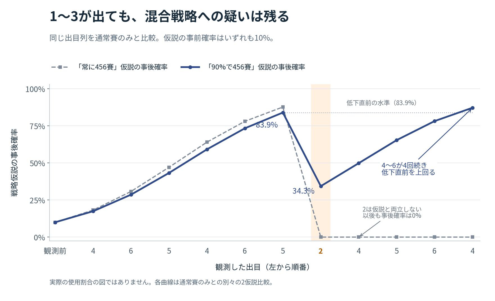
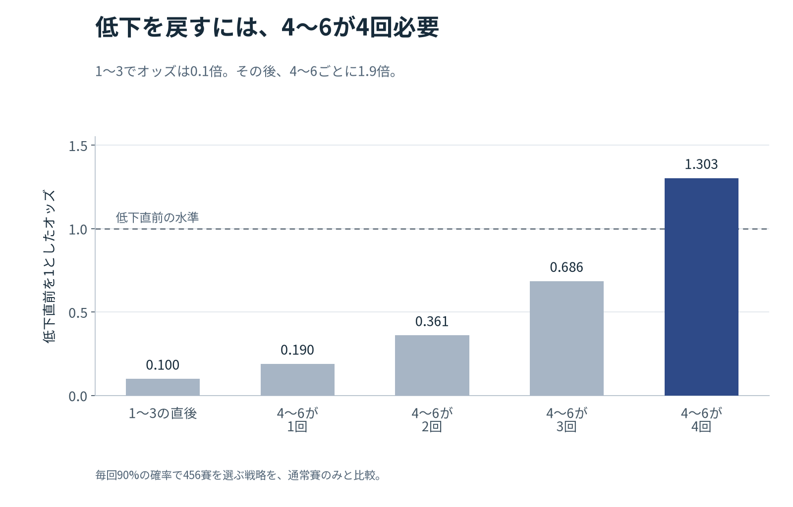

4・5・6ばかりが続いていたところに、2が出た。

「イカサマなのでは？」と思い始めていたとしても、普通の出目が出ると、少し見方が変わりそうです。

前回のモデルでは、その1回で「常に456賽を使う」という仮説の確率が0になりました。ただ、相手が通常のサイコロも混ぜていたら、どうでしょうか。

今回は、その可能性を仮説に入れてみます。すると、1〜3が出た後も疑いは残り、さらに、疑いが上がる出目と下がる出目では、効き方が違うことが分かります。

90%の確率で456賽を選ぶ設定では、1〜3を1回見た後、4〜6が1回出るだけでは、低下する前の水準へ戻りません。少なくとも4回の4〜6が必要になります。

その理由を、[第2回](https://github.com/okamasaya/underground_ChinChiro_with_baysian/blob/main/articles/chinchiro-bayes-02-priors.md)で使った「支持の比」、つまりオッズから見てみます。

## 「普通の目も出る」使い方を、候補に入れる

前回は、「通常賽だけを使う」と「456賽だけを使う」を比較しました。今回は、後者を変更します。

- **通常賽だけを使う。** 毎回、1〜6が等確率で出る。
- **456賽と通常賽を混ぜて使う。** 毎回独立に、90%の確率で456賽、10%の確率で通常賽を選ぶ。

まだサイコロ1個のモデルです。振る前に種類を選び、次に振るときには、改めて同じ確率で選び直すと仮定します。3個一式や振り直し、勝負どころでの使い分けは、後の回で扱います。

この使い方を記録だけから自動的に発見した、という話ではありません。「こういう戦略なら、普通の出目も説明できるのでは」と、比較する候補をこちらで置いています。

仕掛けの候補を思いつくことと、候補を記録から評価することを分けたうえで、今回は評価の計算を進めます。

## 通常賽が10%でも、1〜3が出る確率は10%ではない

混合戦略の下で、4〜6が出る確率を考えます。

456賽を選ぶ90%のときは、必ず4〜6が出ます。通常賽を選ぶ10%のときにも、その半分では4〜6が出ます。合わせると、4〜6が出る確率は95%になります。

1〜3が出るのは、通常賽を選び、さらにその通常賽が1〜3を出すときです。確率は10%の半分、5%です。

| 観測 | 通常賽だけを使う | 90%の確率で456賽を選ぶ |
| --- | ---: | ---: |
| 4〜6が出た | 50% | 95% |
| 1〜3が出た | 50% | 5% |

このモデルでは、1〜3が出れば、その回に選ばれたのは通常賽だったと分かります。ただし、それで「通常賽と456賽を混ぜる戦略」全体が否定されるわけではありません。

混合戦略は、最初から通常賽を使う場合も含めた説明だからです。

## 使う割合と、仮説に置く確率は別のもの

計算を始める前に、二つの確率を整理しておきます。

- **90%**：混合戦略を取る場合に、1回ごとに456賽を選ぶ確率。
- **10%**：観測前に、こちらが「その混合戦略を取っている」という仮説に置く確率。

前者は相手の使い方について置いた条件、後者は二つの仮説を比較するときの出発点です。

今回は使用率90%を決めたうえで、戦略仮説への確率を更新します。実際の使用率が何%なのかまで、同時に推定しているわけではありません。

この数字と以下の出目列は説明用の設定で、原作の対局や人間の心理を測った値ではありません。

## 同じ出目でも、更新に使う値が変わる

混合戦略の事前確率を10%とし、4〜6が1回出たとします。

前回と同じように、「事前確率 × その仮説での出目の出やすさ」を計算し、合計が1になるように割り直します。

$$
\frac{0.10\times0.95}{0.10\times0.95+0.90\times0.50}
\simeq17.4\%
$$

混合戦略に置く確率は、10%から約17.4%へ上がりました。前回の「常に456賽」では、同じ1回で約18.2%でした。

通常賽も混ぜる分、4〜6の出やすさは100%から95%へ変わっています。観測した出目は同じでも、仮説が予測する出やすさが変わるため、更新量も変わります。

## 同じ出目列を、二つの仮説で読み直す

次の出目列で、更新を繰り返してみます。

> 4 → 6 → 5 → 4 → 6 → 5 → **2** → 4 → 5 → 6 → 4

[第0回](https://github.com/okamasaya/underground_ChinChiro_with_baysian/blob/main/articles/chinchiro-bayes-00-overview.md)の図と同じ出目列に、最後の4を一つ加えたものです。原作の記録や無作為な実験結果ではなく、挙動を見せるための例です。

同じ記録に対して、「常に456賽」と「90%の確率で456賽を選ぶ戦略」を、それぞれ通常賽のみの仮説と比較します。どちらの比較も、戦略側の事前確率は10%です。

観察者には、実際にどちらの賽が使われたかは分かりません。分かっているのは出目の記録です。その同じ記録を、二つの仮説比較に使います。

:::message
**図の線は、「実際に456賽を使った割合」ではなく、「記録を見た後、その戦略仮説に置く確率」です。**

灰色線は、「最初からずっと456賽を使っていた」という説明への支持を示します。本当に常に456賽を使うなら2は出ません。だからこそ、記録に2が現れた時点で、その説明への確率が0になります。

各戦略から別々の出目列を作って比べる図ではなく、**2を含む同じ出目列を、異なる仮説で評価する図**として見てください。
:::



*2本の線は、通常賽のみとの別々の2仮説比較です。3種類の仮説に同時に確率を割り当てた図ではありません。*

図には、役割の違う2種類の灰色の線があります。

- **四角い点を結んだ灰色の破線**：「常に456賽を使う」という仮説の確率の推移です。
- **83.9%の高さにある細い灰色の水平点線**：青線が2を見る直前に達していた水準です。その後の回復を比べるための補助線です。

「常に456賽」の線は、2が出たところで0になり、その後も0のままです。本当に常に456賽を使っているなら、2は出ません。この図では、2を含む同じ記録を見て「最初からずっと456賽だった」という仮説を評価しているため、その仮説では観測を説明できなくなります。

その後に4〜6が続いても、「途中に2が出た」という過去の記録は残ります。全記録に対するこの仮説の尤度は0のままなので、事後確率も復活しません。「2が出た後から456賽へ持ち替えた」という説明を考えるなら、別の仮説を置く必要があります。

一方、混合戦略では通常賽を使う場合も含めているため、2が出ても説明は残ります。青線は約83.9%から約34.3%へ下がりますが、0にはなりません。

| 観測したところまで | 混合戦略に置く確率 |
| --- | ---: |
| 最初の4〜6が6回続いた | 83.9% |
| その次に2が出た | 34.3% |
| その後、4〜6が1回出た | 49.8% |
| その後、4〜6が2回続いた | 65.4% |
| その後、4〜6が3回続いた | 78.2% |
| その後、4〜6が4回続いた | 87.2% |

表示は小数点以下1桁に丸めていますが、計算途中では丸めていません。

1回の2で大きく下がり、4〜6が3回続いても、直前の83.9%には戻っていません。4回続くと、ようやく上回ります。

## 上がる1回と、下がる1回は釣り合わない

この違いは、オッズへ掛ける倍率で見ると分かりやすくなります。

4〜6は、混合戦略では確率0.95、通常賽のみでは確率0.50で出ます。したがって、4〜6を1回見ると、混合戦略を支持するオッズは**1.9倍**になります。

1〜3は、混合戦略では確率0.05、通常賽のみでは確率0.50で出ます。こちらを見ると、オッズは**0.1倍**になります。

| 観測 | 出やすさの比 | オッズへの倍率 |
| --- | ---: | ---: |
| 4〜6が出た | 0.95 ÷ 0.50 | 1.9倍 |
| 1〜3が出た | 0.05 ÷ 0.50 | 0.1倍 |

「疑いが上がる出目を1回」と「下がる出目を1回」があっても、倍率の積は1.9 × 0.1で0.19です。元の1へ戻りません。

1〜3を見る直前のオッズを1とすれば、その後の変化は次のようになります。



*1〜3の直後は0.1倍、その後は4〜6が出るたびに1.9倍。図中は小数点以下3桁表示です。*

3回なら約0.686倍で、まだ戻りません。4回なら約1.303倍となり、低下直前を上回ります。

この「4回」は、使用率90%という今回の設定で、1〜3の後に4〜6だけが続いた場合の値です。平均して4回振れば戻る、という意味ではありません。

また、0.1倍になるのは**オッズ**です。仮説に置く確率そのものを10分の1にするわけではありません。実際、図の確率は83.9%から34.3%へ変わっています。

## 普通の出目を、どう受け止めるか

1〜3が出ると、混合戦略への疑いは下がります。それは、今回の戦略がその出目を5%としか予測せず、通常賽のみなら50%で出るからです。

「普通の目が出たから安心」という印象を、そのまま数字にしたものではありません。比較する仮説ごとに、その観測の出やすさを考えた結果です。

「常に使う」なら1〜3の出やすさは0。「通常賽も混ぜる」なら今回は5%。どんな使い方を候補に入れるかで、同じ記録の読み方は変わります。

この単純なモデルの下では、4〜6と1〜3の回数が同じなら、順番を並べ替えても最後の事後確率は同じです。一方、途中の推移や、最初にある閾値を超える時点は順番で変わります。

「いつ使うか」まで考え始めると、局面と記録の対応も必要になります。勝負どころでの使い分けは、第5回で扱います。

## 次回は、サイコロ3個と勝敗へ

ここまでの観測は、サイコロ1個の「1〜3／4〜6」でした。

実際のチンチロでは3個で役を作り、振り直しがあり、相手の役と比べて勝敗が決まります。456賽を使っていても、相手の役によっては負けます。

第4回では、3個一式のモデルへ進み、「どんな出目だったか」と「勝ったか負けたか」で、得られる情報がどう違うかを見ていきます。

## 詳しい資料・コード

- **[今回の2枚の図を再生成するPythonコード](https://github.com/okamasaya/underground_ChinChiro_with_baysian/blob/main/articles/assets/plot_chinchiro_mixture.py)**
  分数で更新し、累積した証拠の倍率による計算との一致を確認してから作図します。
- **[Full paper：モデル・導出・検証の詳細](https://github.com/okamasaya/underground_ChinChiro_with_baysian/blob/main/kaiji_ungr_456dice.pdf)**
  第4節「通常賽を混ぜる単一賽モデル」に対応します。使用率を記号で表した更新式、証拠の非対称性、観測の順序についても扱っています。
- **[Letter：主要結果をまとめた4ページの資料](https://github.com/okamasaya/underground_ChinChiro_with_baysian/blob/main/kaiji_bayes_letter_20261105.pdf)**
  第2節で単一賽の混合モデルとオッズ更新を紹介しています。
- **[GitHubリポジトリ](https://github.com/okamasaya/underground_ChinChiro_with_baysian)**
  計算コード、図版、保存データを収録しています。実行環境は[再現手順](https://github.com/okamasaya/underground_ChinChiro_with_baysian/blob/main/docs/REPRODUCIBILITY.md)を参照してください。

:::details 今回の更新を、標準ライブラリだけで確かめる

`eta`は、混合戦略を取るときの456賽の使用率です。各仮説での出目の出やすさから更新し、図と表に対応する6回目以降の値を表示します。

```python
from fractions import Fraction


def update(prior, high, eta=Fraction(9, 10)):
    likelihood = (1 + eta) / 2 if high else (1 - eta) / 2
    weight_strategy = prior * likelihood
    weight_fair = (1 - prior) * Fraction(1, 2)
    return weight_strategy / (weight_strategy + weight_fair)


observations = (4, 6, 5, 4, 6, 5, 2, 4, 5, 6, 4)
posterior = Fraction(1, 10)
for n, die in enumerate(observations, start=1):
    posterior = update(posterior, high=(die >= 4))
    if n >= 6:
        print(f"{n}回目・出目{die}: {float(posterior):.1%}")
```

:::
