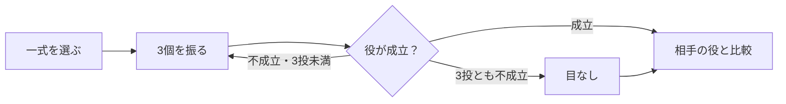

イカサマを疑っていた相手が、負けた。

「この人も普通に負けるのか」と思えば、疑いが少し薄れるかもしれません。ただ、仕掛けを使っていても、必ず勝てるとは限りません。

これまではサイコロ1個を見て、「1〜3が出た／4〜6が出た」という記録から更新してきました。今回は3個で役を作り、相手と勝敗を比べるところまで進めます。

そこで見えてくるのは、**勝ち負けが同じでも、出目の記録が持つ意味は違う**ということです。

[第3回](https://github.com/okamasaya/underground_ChinChiro_with_baysian/blob/main/articles/chinchiro-bayes-03-mixture.md)では、通常賽を混ぜると、1〜3が出ても戦略への疑いが残ることを見ました。今回は、その使い方を3個一式へ広げます。[シリーズ全体の案内は第0回](https://github.com/okamasaya/underground_ChinChiro_with_baysian/blob/main/articles/chinchiro-bayes-00-overview.md)にあります。

## まず、どんな勝負を計算するかを決める

チンチロの勝敗を考えるには、サイコロの分布だけでなく、役の強さや振り直しの規則も必要です。

今回は、次のモデルで計算します。

- 自分と相手は、それぞれ3個のサイコロを振る。
- 自分は手番の開始時に、通常賽一式か456賽一式を選ぶ。
- 振り直す間は同じ一式を使い、途中では持ち替えない。
- 役ができたら終了。できなければ振り直し、最大3投までとする。
- 相手は通常賽を使い、双方が独立に手番を終えて、最後の役を比較する。

親の役によって相手が振らずに終わる規則や、サイコロが器からこぼれる場合は、この計算には入れません。

役の順位も固定します。

> ピンゾロ ＞ 2〜6のゾロ目 ＞ シゴロ ＞ 6の目 ＞ 5の目 ＞ … ＞ 1の目 ＞ 目なし ＞ ヒフミ

2〜6のゾロ目はすべて同格、同じ強さなら引き分けです。これはFull paperの「順位A」に対応する説明用の設定で、原作の細かなルールを確定したものではありません。

以下の勝率や敗北率は、この規則の下での計算値です。

## 出目から役へ、役から勝敗へ

例えば、4・4・6なら、そろった2個とは別の目を取り、「6の目」になります。2・2・6でも同じ6の目です。

4・5・6が1個ずつならシゴロ。2・3・4のように役がなければ、まだ投げられる回数が残っている間は振り直します。

通常賽では、3個の出目は216通りあります。そのうち半分は1投で役ができないため、振り直しが起こります。3投とも役ができずに終わる確率は、半分を3回掛けた12.5%です。

一方、456賽の出目は27通りです。3個とも同じならゾロ目、2個が同じなら4〜6の目、全部違えばシゴロになります。

**今回の456賽は、最初の1投で必ず役ができます。**

最終役の分布を比べる際には、通常賽側の振り直しも含める必要があります。両者を単に216通りと27通りの1投だけで比較すると、ここで決めた勝負とは違ってしまいます。

## 456賽で「6の目」を出しても、負ける

456賽で6の目を出したとします。

相手の通常賽がシゴロやゾロ目を出せば、こちらの負けです。通常賽側は最大3投まで振れるので、その最終役の分布から敗北率を計算します。

同じことを、456賽側の各役について調べると、次のようになります。

| 456賽側で出た役 | 通常賽の相手に負ける確率 |
| --- | ---: |
| 444・555・666 | 0.8% |
| シゴロ | 4.9% |
| 6の目 | 9.7% |
| 5の目 | 21.9% |
| 4の目 | 34.0% |

これは、**その役が出たと分かった後の条件付き敗北率**です。「その役が出て、さらに負ける確率」とは違います。

例えば、4の目なら、この設定では約34%の確率で負けます。456賽を使っているのに負けることは、十分あり得ます。

役が分かる前の勝敗を求めるには、これらを456賽側の役の出やすさで重み付けします。結果は、勝ち約74.6%、引き分け約9.6%、負け約15.8%です。

これも原作から測った勝率ではありません。役順位や対局規則を変えれば値も変わります。また、勝率と金銭的な利益は別で、損益を考えるには賭け金や配当も必要です。

## 同じ「6の目で勝った」でも、証拠の向きが変わる

ここで、記録を見る側に戻ります。

第3回と同じように、次の二つの仮説を比較します。

- **通常賽だけを使う。**
- **手番ごとに、90%の確率で456賽一式、10%の確率で通常賽一式を選ぶ。**

相手は、どちらの仮説でも通常賽を使います。

こちらが最初の1投で6の目を出し、相手が5の目だったため勝ったとします。本人の出目が、次の二通りだった場合を考えます。

| 最初の1投の出目 | 最終役 | 勝敗 |
| --- | --- | --- |
| 4・4・6 | 6の目 | 勝ち |
| 2・2・6 | 6の目 | 勝ち |

役と勝敗は同じです。しかし、4・4・6は456賽でも出せますが、2・2・6は456賽では出せません。

したがって、混合戦略を支持する証拠としては、違う働きをします。

今回の設定では、4・4・6を見れば混合戦略を支持するオッズは7.3倍、2・2・6なら0.1倍になります。**同じ役で勝っているのに、一方は疑いを強め、もう一方は弱める。**

勝敗だけを残した記録や、最終役だけの記録では、この違いを取り出せません。

## 3個を別々のサイコロとして計算してよいのか

第3回では、1個のサイコロを観測するごとに種類を選び直していました。今回は、3個一式の種類をまとめて選びます。

ここには、計算上も違いがあります。

通常賽だけなら、最初の1投で3個とも4〜6になる確率は、半分を3回掛けた12.5%です。

456賽一式なら、3個とも4〜6になる確率は100%。したがって、使用率90%の混合戦略では、

$$
0.90\times1+0.10\times\frac18
=\frac{73}{80}
=91.25\%
$$

となります。通常賽のみの12.5%と比べると、出やすさは7.3倍です。これが、先ほどのオッズへの倍率です。

反対に、1個でも1〜3が含まれたら、その一式は通常賽だったことになります。混合戦略では通常賽を選ぶ確率が10%なので、通常賽のみと比べた倍率は0.1です。

ここで、各サイコロの4〜6の出やすさを95%とし、95%を3回掛けると約85.7%になります。しかし、それは今回の91.25%とは一致しません。

3個が同じ種類を共有しているためです。種類が分かれば個々の出目は独立でも、種類が分からないまま混ぜた分布では、そのまま独立として掛け合わせられません。

「3個のサイコロを使う」といっても、1個ずつ種類を選ぶのか、一式で選ぶのかを決める必要があります。

## 記録は細かければ、そのまま証拠も増えるのか

出目まで残す意味はありますが、細かな記録をすべて別々の証拠として掛ければよい、というわけではありません。

勝敗は、双方の最終役と、決めた役順位から決まります。すでに双方の全投擲履歴を使っているなら、そこから分かる勝敗を独立な追加証拠として掛けると、同じ情報を二重に数えることになります。

また、今回の二つの仮説では、**第1投が3個とも4〜6だったかどうか**だけで、手番の全投擲履歴と同じ尤度比を保てます。

3個とも4〜6なら、今回の規則では必ずその投で役が成立し、倍率は7.3。1個でも1〜3があれば、456賽一式では起こらない履歴なので倍率は0.1です。

つまり、このモデルの仮説比較に必要な情報は、小さくまとめられます。

ただし、それを最初から「勝ち／負け」にまとめてしまうと、先ほどの二つの6の目を区別できません。**どこまで情報をまとめてよいかは、比較する仮説によって決まる**ということです。

後から別の使い方や規則を調べたくなることもあります。三好の記録を考えるうえでは、後で読み直せる形で情報が残っている意味も大きそうです。

## 次回は、勝負どころと記録を対応させる

今回は、一式を選ぶ確率が、毎手番同じという戦略でした。

しかし、「普段は通常賽を使い、勝負どころで456賽を使う」という相手なら、出目だけでなく、いつの記録なのかも必要になります。

第5回は、賭け金などの局面と出目を対応させて、シリーズの入口だった「ここ一番での違和感」に戻ります。

## 詳しい資料・コード

- **[厳密な役分布・勝敗の計算コード](https://github.com/okamasaya/underground_ChinChiro_with_baysian/blob/main/analysis/chinchiro_model.py)**
  通常賽216通り、456賽27通り、最大3投の停止規則、役ごとの条件付き勝敗などを分数で計算しています。
- **[Full paper：モデル・導出・検証の詳細](https://github.com/okamasaya/underground_ChinChiro_with_baysian/blob/main/kaiji_ungr_456dice.pdf)**
  第5〜9節の3個一式、振り直し、役分布、勝敗の計算に対応します。特に「456賽の最終役ごとに、負ける確率を求める」と図A15を参照してください。
- **[Letter：主要結果をまとめた4ページの資料](https://github.com/okamasaya/underground_ChinChiro_with_baysian/blob/main/kaiji_bayes_letter_20261105.pdf)**
  観測単位や、共有する種類を考慮する必要性など、全体の見通しを確認できます。
- **[GitHubリポジトリ](https://github.com/okamasaya/underground_ChinChiro_with_baysian)**
  図版と保存データ、[再現手順](https://github.com/okamasaya/underground_ChinChiro_with_baysian/blob/main/docs/REPRODUCIBILITY.md)を収録しています。

物語の着想は、福本伸行『賭博破戒録カイジ』の地下チンチロ編によります。本文のモデルは、原作の対局や登場人物の心理を数値的に再現したものではありません。
