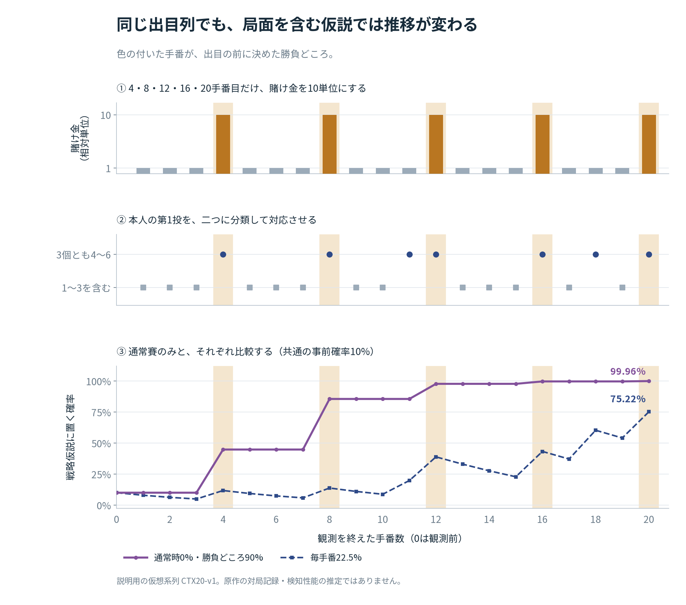

普段は負けることもある。それなのに、賭け金が大きくなると強い。

全体の勝ち負けを数えているだけでは、この違和感を捉えにくいかもしれません。何回勝ったかに加えて、「どんな場面で、どんな出目だったか」を見たくなります。

三好の記録と、そこに目を向けるカイジ。シリーズの入口に置いたこのつながりへ、今回は戻ります。

[第4回](https://github.com/okamasaya/underground_ChinChiro_with_baysian/blob/main/articles/chinchiro-bayes-04-outcomes.md)では、456賽でも負けること、同じ勝敗でも出目によって証拠の向きが変わることを見ました。今回は、さらに**出目と局面の対応**を考えます。[シリーズ全体の案内は第0回](https://github.com/okamasaya/underground_ChinChiro_with_baysian/blob/main/articles/chinchiro-bayes-00-overview.md)にあります。

## 「いつも使う」と「ここで使う」は、違う説明になる

これまでの混合戦略は、どの手番でも同じ確率で456賽を選ぶものでした。

しかし、相手が「普段は通常賽を使い、勝負どころで456賽を使う」としたら、毎手番同じ出やすさで考えるのは、その戦略に合っていません。

そこで、次の二つの仮説を比較します。

- **通常賽だけを使う。** 局面にかかわらず、毎手番通常賽一式を使う。
- **局面に応じて使い分ける。** 通常時は通常賽一式、勝負どころでは90%の確率で456賽一式を選ぶ。

勝負どころでも、残り10%では通常賽を使います。手番ごとに独立に一式を選び、振り直しの間は同じ一式を使うという第4回の設定を引き継ぎます。

ここでいう「勝負どころ」は、**出目が出る前に分かる条件**です。今回は賭け金で区切り、どの手番で賭け金が大きくなるかも、あらかじめ決めます。

「勝った手番だから勝負どころだった」と、結果から選ぶわけではありません。

## 普段の出目では、疑いが下がらなくなる

例えば、通常時に1〜3を含む出目が出たとします。

第4回の「毎手番90%で456賽を選ぶ戦略」なら、その記録は戦略への疑いを弱めました。通常賽のみと比べ、オッズへ掛ける倍率は0.1でした。

今回の局面別の戦略は、通常時には通常賽を使うと予測しています。「通常賽だけを使う」という仮説も、その場面では同じ予測です。

両者で出やすさが同じなら、出やすさの比、つまりベイズ因子は1です。したがって、オッズも事後確率も変わりません。

これは、普段の1〜3を都合よく無視した結果ではありません。**その局面では、比較する二つの仮説が同じ分布を予測する**ためです。

逆に、通常時に3個とも4〜6が出ても、今回の比較では疑いは強まりません。どちらの仮説でも、通常賽から出たと考える場面だからです。

勝負どころでは、使用率90%なので第4回と同じ倍率になります。

| その手番の第1投 | 通常時の倍率 | 勝負どころの倍率 |
| --- | ---: | ---: |
| 3個とも4〜6 | 1倍 | 7.3倍 |
| 1個でも1〜3を含む | 1倍 | 0.1倍 |

この表は、局面別の戦略を通常賽のみと比べたときの、**オッズへの倍率**です。事後確率そのものを7.3倍するわけではありません。

第4回で確認したとおり、今回の停止規則では、第1投のこの分類だけで全投擲履歴と同じ尤度比を保てます。3個とも4〜6なら必ずその投で役が成立し、1〜3を含めば、その手番は通常賽だったと分かるためです。

## 賭け金と出目を対応させた、20手番の例

論文で使った仮想系列を、一つ見てみます。

勝負どころを4・8・12・16・20手番目とし、その5手番の賭け金を10単位、それ以外の15手番を1単位とします。この予定表は、出目を生成する前に固定しています。

局面別の戦略に従って本人の出目を生成し、相手には通常賽を使わせます。双方とも、役ができれば終了、目なしなら最大3投まで振り直します。勝敗には第4回と同じ順位を使います。

この系列は、原作の対局記録でも、検知しやすさを推定するための大量の模擬実験でもありません。相手の乱数種は、勝負どころでの敗戦も含む例になるよう選んでいます。**挙動を読むための一例**として見てください。

記録を第1投の出目でまとめると、次のようになりました。

| 局面 | 手番数 | 3個とも4〜6 | 1〜3を含む |
| --- | ---: | ---: | ---: |
| 通常時 | 15 | 2 | 13 |
| 勝負どころ | 5 | 5 | 0 |
| 全体 | 20 | 7 | 13 |

全体なら「20手番中7回」です。しかし、局面と対応させれば、勝負どころの5手番すべてが3個とも4〜6だったことが分かります。

ここで、局面を使わない別の戦略も比較用に置きます。**毎手番22.5%の確率で456賽一式を選ぶ戦略**です。

22.5%は、この予定表での平均使用率です。

$$
\frac{5\times0.90+15\times0}{20}=0.225
$$

これは、20手番で必ず何回か456賽を使う、という指定ではありません。使用回数の期待値はどちらの戦略も4.5回ですが、使う場面についての予測が違います。

局面別の戦略も、一定使用率の戦略も、それぞれ通常賽のみと比較します。戦略側の事前確率は、どちらの比較でも10%とします。

*上段は賭け金、中段は本人の第1投、下段は仮説確率です。色を付けた縦帯が勝負どころ。2本の線は、通常賽のみとの別々の2仮説比較で、三つの仮説へ同時に確率を割り当てた図ではありません。*

局面別の戦略の線は、通常時に横ばいです。この例では勝負どころの出目が毎回オッズを7.3倍にするため、その手番だけで上がっています。

一方、一定使用率の戦略は、通常時にも456賽を使う可能性を予測します。1〜3を含む出目ではオッズが0.775倍、3個とも4〜6なら2.575倍になり、通常時にも上下します。

| 観測したところまで | 局面別の戦略に置く確率 | 一定使用率22.5%の戦略に置く確率 |
| --- | ---: | ---: |
| 4手番 | 44.79% | 11.75% |
| 8手番 | 85.55% | 13.77% |
| 12手番 | 97.74% | 38.87% |
| 16手番 | 99.68% | 43.25% |
| 20手番 | 99.96% | 75.22% |

図の終点と表は小数点以下2桁に丸め、途中の計算では丸めていません。99.96%は、確率1になったという意味ではありません。

二つの線は、**同じ仮説を違う精度で計算したものではなく、予測の異なる仮説を置いた結果**です。この差から、局面別のモデルがいつも正しい、いつも早く検知できる、とは言えません。

## 勝負どころで負けても、出目は戦略を支持する

8手番目を、もう少し詳しく見ます。

本人の出目は4・6・5で、シゴロ。相手は最初に5・3・2で目なし、振り直して4・4・4でした。今回の順位ではゾロ目のほうが強いので、本人は負けています。

それでも、本人の第1投は3個とも4〜6です。勝負どころにこの出目を観測したとき、局面別の戦略を支持するオッズは7.3倍になります。

実際、その戦略に置く確率は、7手番後の約44.79%から、8手番後の約85.55%へ上がっています。

**「負けた」という印象と、「その出目がどちらの仮説で出やすいか」は、分けて考える必要があります。**

推定に使っているのは、事前に分かる局面と、本人の全投擲履歴です。生成時にどちらの賽を選んだかという、観察者には見えない正解は使っていません。

相手の出目の分布は両仮説で同じなので、その尤度は比で相殺されます。また、双方の出目から決まる勝敗を、独立な追加証拠として掛け合わせることもしません。

## 「勝負どころを見る」は、都合のよい記録を選ぶことではない

今回の計算では、通常時を含む20手番すべてを使っています。そのうえで、各手番の局面に応じた出やすさを計算しています。

出目を見る前に決めた高額の手番で1〜3が出れば、局面別の戦略への疑いは下がります。勝負どころに起きた不都合な記録も、同じ規則で評価します。

反対に、出目を見終わってから、4〜6がそろった手番だけを「勝負どころ」と呼べば、偏りは簡単に作れます。そのように選んだ記録へ、今回の計算をそのまま当てはめることはできません。

賭け金が出目より前に分かっていても、十分とは限りません。たくさんの区切り方を試し、最も疑わしく見えた条件だけを採用したなら、その選び方も考える必要があります。

記録を読み返して「高額のときだけ使うのでは」と思いつくこと自体には意味があります。ただし、**仮説を思いつくために使った記録と、その仮説を確かめるための観測を区別したい**ところです。

例えば、考えた条件や使用率を固定して、その後の記録でも同じ傾向が続くかを確かめる方法があります。実際に賭け金が過去の勝敗で変わる場合には、その決まり方や履歴も含めてモデルを考え直します。

## 三好の記録と、カイジの着眼点

出目の回数だけが残っていたら、「全体で7回」と数えることはできます。しかし、いつの出目だったかを失えば、勝負どころの5手番と対応させ直せません。

局面を対応させた記録なら、「毎手番同じ割合で使う」と「高額のときに使う」という、予測の違う説明を考えられます。

三好が情報を残すことと、カイジが記録の読み方を変えること。この二つの役割を、データの保存と、比較する仮説の構成として捉えられそうです。

ただし、今回の計算が、記録から仕掛けの候補を自動的に発見したわけではありません。通常時0%、勝負どころ90%という使用率も、こちらで置いた仮定です。実際の使用率を推定した値ではなく、カイジの心理を数字にしたものでもありません。

「全体ではなく、勝負どころを見る」という今回の題は、全体の記録を捨てるという意味ではありません。**記録を集計するときに、局面との対応を失わない**ということです。

## 次回は、「99%怪しい」の意味を確かめる

今回の局面別の戦略は、20手番後に約99.96%になりました。

では、同じように高い確率になったら、通常賽だけの相手を誤って疑うことは、ほとんどないのでしょうか。毎手番、途中の確率を確認し続けてもよいのでしょうか。

第6回は、仮説に置く事後確率と、誤って疑う頻度を分けて考えます。

## 詳しい資料・コード

- **[今回の図を再生成するPythonコード](https://github.com/okamasaya/underground_ChinChiro_with_baysian/blob/main/articles/assets/plot_chinchiro_context.py)**
  共通モデルの仮想系列を使い、分数で計算した更新と、第1投の分類による更新の一致を確かめてから作図します。
- **[局面別の仮想系列・全投擲履歴の共通コード](https://github.com/okamasaya/underground_ChinChiro_with_baysian/blob/main/analysis/chinchiro_model.py)**
  `context_records()`が、事前に決めた局面、本人と相手の出目、勝敗などを生成します。設定IDは`CTX20-v1`、乱数種は本人が`20261103`、相手が`20261108`です。
- **[Full paper：モデル・導出・検証の詳細](https://github.com/okamasaya/underground_ChinChiro_with_baysian/blob/main/kaiji_ungr_456dice.pdf)**
  第6節の「勝負どころで一式を選ぶ局面別モデル」と図A14に対応します。第12節では、仮説の選び方や、局面と出目の対応を残す意味も検討しています。
- **[Letter：主要結果をまとめた4ページの資料](https://github.com/okamasaya/underground_ChinChiro_with_baysian/blob/main/kaiji_bayes_letter_20261105.pdf)**
  全体の問いと、モデルに条件を加える見通しを確認できます。
- **[GitHubリポジトリ](https://github.com/okamasaya/underground_ChinChiro_with_baysian)**
  図版と保存データ、[再現手順](https://github.com/okamasaya/underground_ChinChiro_with_baysian/blob/main/docs/REPRODUCIBILITY.md)を収録しています。

物語の着想は、福本伸行『賭博破戒録カイジ』の地下チンチロ編によります。本文のモデルと仮想系列は、原作の実対局や登場人物の心理を数値的に再現したものではありません。
