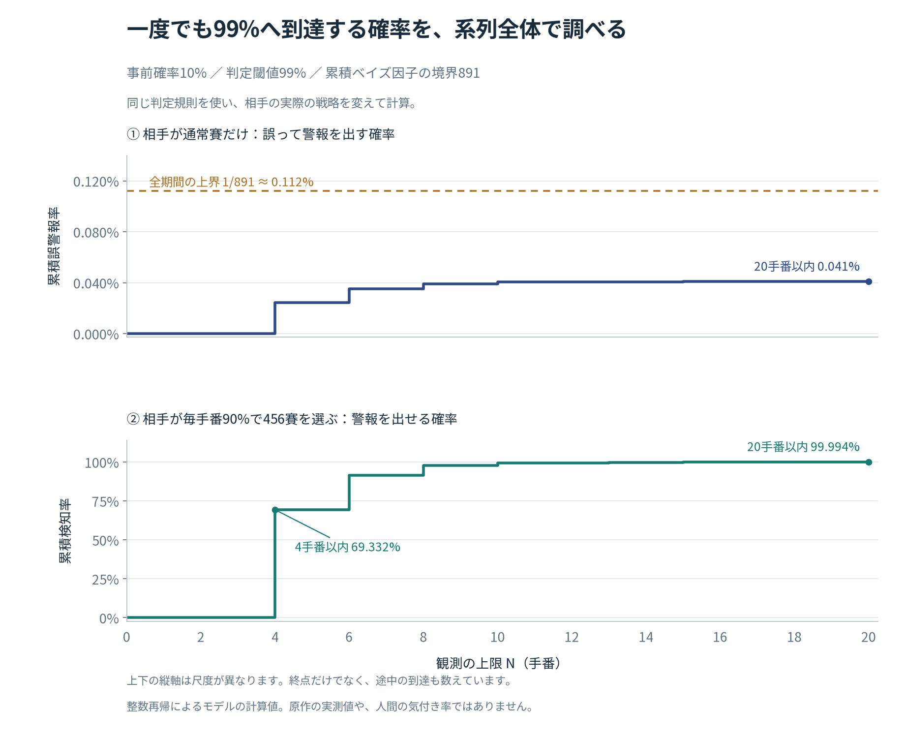

記録から計算した、戦略仮説の確率が99%を超えた。

ここまで来れば、ほぼ確かだと思いたくなります。けれど、通常賽だけを使っている相手でも、偶然偏った出目が続くことはあります。

では、「99%怪しい」と判定する規則は、どのくらい誤るのでしょうか。毎手番、途中の確率を確認し続けてもよいのでしょうか。

[第5回](https://github.com/okamasaya/underground_ChinChiro_with_baysian/blob/main/articles/chinchiro-bayes-05-context.md)では、局面と出目を対応させた仮想系列で、戦略仮説の確率が約99.96%になりました。今回は一つの系列から離れ、**同じ規則を、得られ得るさまざまな記録へ適用したらどうなるか**を考えます。[シリーズ全体の案内は第0回](https://github.com/okamasaya/underground_ChinChiro_with_baysian/blob/main/articles/chinchiro-bayes-00-overview.md)にあります。

## 「この記録なら99%」と「何回中何回誤るか」

まず、問いを二つに分けます。

| 知りたいこと | 何を条件にするか | 計算するもの |
| --- | --- | --- |
| この記録を見た後、戦略仮説にどのくらい確率を置くか | 観測した記録 | 事後確率 |
| 通常賽だけの相手にも、どのくらい警報を出してしまうか | 通常賽だけを使うという条件 | 誤警報率 |

今回の二つの仮説の比較で、戦略側の事後確率が99%なら、通常賽のみの側は1%です。ただし、それは**比較する仮説と事前確率を置き、その記録を観測した後の確率**です。

通常賽の相手を何度も観測したとき、警報が出る頻度を直接表してはいません。

向きが違うのです。「記録があるときの仮説の確率」と、「仮説を固定したときに、ある種の記録が得られる確率」を入れ替えることはできません。

以下では、事後確率が99%以上になったら警報を出す、という計算上の規則を置きます。一度でも到達すれば警報ありと数えます。

## 何を観測し、どんな規則で判定するか

計算を追いやすくするため、まずは第4回の**毎手番同じ使用率**のモデルで考えます。

- **通常賽だけを使う。** 毎手番、通常賽一式を使う。
- **毎手番90%の確率で456賽一式を選ぶ。** 残り10%では通常賽一式を使う。

手番ごとに独立に一式を選び、振り直しの間は同じ一式を使います。役ができれば終了し、目なしなら最大3投まで振り直します。

推定に使うのは全投擲履歴です。ただし、この二つの仮説では、第1投が「3個とも4〜6かどうか」という分類で、全履歴と同じ尤度比を保てます。

| 本人の第1投 | 通常賽だけの場合の確率 | オッズへの倍率 |
| --- | ---: | ---: |
| 3個とも4〜6 | 1/8 | 7.3倍 |
| 1〜3を含む | 7/8 | 0.1倍 |

振り直した手番も含め、途中の記録はすべて更新に使います。観測の開始点、二つの仮説、戦略側の事前確率10%、判定閾値99%を、観測前に決めます。

## 99%へ上げるには、どのくらいの証拠が必要か

確率をオッズに直すと、必要な証拠量が分かります。

事前確率10%のオッズは、10対90、つまり1対9です。99%のオッズは99対1なので、最初のオッズを891倍にする必要があります。

各手番の倍率を掛け合わせたものを、累積ベイズ因子と呼び、$M_n$と書きます。観測前は$M_0=1$です。

$$
\frac{1}{9}\times M_n\ge99
\quad\Longleftrightarrow\quad
M_n\ge891
$$

これが、今回の「99%以上なら警報」という規則に対応する証拠の境界です。

例えば、観測開始から3手番連続で3個とも4〜6なら、事後確率は約97.739%。4手番続けば約99.684%になり、初めて警報が出ます。

その次に1〜3を含む出目が出ると、約96.928%へ下がります。それでも、**すでに一度警報が出た系列**として数えます。

「20手番目の確率が99%以上か」だけを調べると、途中で警報が出てから下がった系列を見落としてしまいます。

## 観測を続けても、誤警報には上界がある

通常賽だけの相手に対して、この累積ベイズ因子はどのように動くでしょうか。

次の手番で7.3倍になる確率は1/8、0.1倍になる確率は7/8です。倍率の平均を取ると、

$$
\frac18\times7.3+\frac78\times0.1=1
$$

となります。

通常賽の仮説が正しければ、どんな過去の記録の後でも、次の倍率の条件付き平均は1です。そのため、累積ベイズ因子は「非負マルチンゲール」という性質を持ちます。

この性質に対する**Ville（ヴィル）の不等式**を使うと、観測を続ける全期間で、一度でも891以上になる確率を抑えられます。

$$
P_0\!\left(\text{いつか }M_n\ge891\right)
\le\frac1{891}
\simeq0.112\%
$$

$P_0$は、通常賽だけを使う場合の確率です。

これは、各時点の誤警報率を足した近似ではありません。**観測を無制限に続けた場合も含めて、一度でも警報が出る確率の上界**です。

ただし、0.112%は上界であり、実際の誤警報率がその値に等しいという意味ではありません。また、事後確率が99%だから誤警報率が1%になる、という計算でもありません。

## 途中を見ることと、何度も始め直すこと

今回の条件では、毎手番確率を確認して、99%へ達したところで止めても、この上界が適用されます。最初から積み重ねた証拠が、いつか境界を超えるかを評価しているからです。

一方、直近4手番だけを何度も取り出し、そのたびに事前確率10%から計算し直すなら、別の規則になります。

通常賽でも、4手番連続で3個とも4〜6になる確率は、ある決まった4手番については$1/4096$です。しかし、独立な4手番の組を際限なく調べれば、いつかその並びが現れる確率は1になります。

そこで毎回「99%を超えた」と警報を出す運用に、先ほどの0.112%の上界は使えません。前の期間に得た不利な証拠を捨て、何度も新しく始めているためです。

**途中で確率を見ることは許しても、都合のよい開始点へ無条件に戻ってよいわけではない**、という区別です。

## 実際には、どのくらい誤り、どのくらい検知するか

上界だけでなく、有限の観測期間についても計算できます。

通常賽だけの場合は「一度でも警報が出る確率」が誤警報率です。毎手番90%で456賽を選ぶ戦略が本当の場合は、同じ到達確率が検知率になります。

論文のコードでは、まだ警報が出ていない状態の重みを更新し、初めて到達した分を取り分けます。出目の分類は二つで、確率は分数なので、整数の重みを使って全経路を集計できます。乱数で大量の系列を作るモンテカルロ計算ではありません。

*事前確率10%・判定閾値99%。上下で縦軸の尺度が違います。下段では、実際の戦略と判定に使う戦略を、ともに使用率90%としています。*

| 観測の上限 | 通常賽だけの相手への誤警報率 | 使用率90%の戦略の検知率 |
| --- | ---: | ---: |
| 4手番 | 0.024% | 69.332% |
| 10手番 | 0.041% | 99.356% |
| 20手番 | 0.041% | 99.994% |

図中の数値と表は小数点以下3桁に丸めています。10手番と20手番の誤警報率は同じ表示ですが、丸める前の値は異なります。

また、20手番以内の検知率99.994%も、必ず検知できるという意味ではありません。未到達率は約0.006%残っています。

この表の誤警報率は、全期間の上界0.112%より小さくなっています。有限期間で区切ることに加え、ベイズ因子が7.3倍へ跳ぶため、警報時に境界891を大きく超える場合があることも、上界と実際の値が一致しない理由になります。

検知率は、実際の使用率や、判定する側がどの戦略を候補にしたかで変わります。この表を、人間がイカサマに気付く確率や、別の戦略にも共通する性能として読むことはできません。

## 同じ99%でも、事前確率で必要な証拠量は変わる

事後確率の閾値を$h$、事前確率を$p_0$とすると、必要な累積ベイズ因子は、

$$
A=\frac{h}{1-h}\frac{1-p_0}{p_0}
$$

です。閾値99%を固定しても、事前確率で$A$が変わります。

| 戦略仮説の事前確率 | 必要な累積ベイズ因子 | 全期間の誤警報率の上界 |
| --- | ---: | ---: |
| 1% | 9801 | 0.010% |
| 10% | 891 | 0.112% |
| 50% | 99 | 1.010% |

ここでも、最後の列は実際の誤警報率ではなく、$1/A$という上界です。

事前確率が高ければ、99%へ達するまでに必要な証拠は少なくなります。事前確率は、確率の出発点だけでなく、この判定規則の誤警報上界にも関係します。

事前確率を変えれば誤警報を小さく見せられる、という使い方を勧めているわけではありません。何を根拠に事前確率を置き、どんな判定規則を採用するかは、結果を見る前に決める必要があります。

## 第5回の「勝負どころ」にも使えるか

局面ごとに使用率を変えても、出目が出る前に使用率が決まるなら、通常賽の下での倍率の条件付き平均は1です。第5回の固定した予定表でも、同じ全期間の上界を使えます。

ただし、検知までの手番数は同じではありません。

前回は4手番ごとに勝負どころがあり、通常時の倍率は1でした。証拠が動くのは勝負どころだけなので、最短の到達に必要な4機会は、平打ちを含めれば16手番です。

今回の表の「4手番」を、そのまま前回の予定表での4手番と読み替えることはできません。

また、上界には条件があります。通常賽の出目の分布、記録や停止の規則が想定どおりであること、結果を見てから都合のよい仮説や局面を選び直していないことが必要です。

たくさんの仮説を同時に試し、どれか一つが99%を超えたら警報にする場合も、一つの仮説についての上界を、そのまま全体へ流用できません。候補の数を考慮した評価や、候補へ事前に重みを置いてベイズ因子を混合する設計などが必要になります。

## 次回は、記録から分かること、分からないこと

今回は、仮説と判定規則を固定することで、通常賽だけの相手へ誤警報を出す確率を評価できました。

ただし、モデルの下で誤警報が小さくても、現実の記録にそのモデルが合っているかは、別に確かめる必要があります。仮説の候補そのものが足りないこともあり得ます。

第7回は、ここまでの推定を何によって確かめられるのか、どこまでが仮定に依存するのかを整理します。見えない状態を記録から考えるとき、数字を出した後にも残る問いを扱います。

## 詳しい資料・コード

- **[今回の図を再生成するPythonコード](https://github.com/okamasaya/underground_ChinChiro_with_baysian/blob/main/articles/assets/plot_chinchiro_false_alarms.py)**
  既存の整数再帰を呼び出し、短い系列の全列挙との一致と、本文の数値を確認してから作図します。
- **[誤警報・初到達の計算コード](https://github.com/okamasaya/underground_ChinChiro_with_baysian/blob/main/analysis/sequential_performance.py)**
  `known_boundaries()`が到達境界を求め、`first_passage()`が初到達と未到達の重みを集計します。閾値との比較と再帰計算には整数を使っています。
- **[Full paper：モデル・導出・検証の詳細](https://github.com/okamasaya/underground_ChinChiro_with_baysian/blob/main/kaiji_ungr_456dice.pdf)**
  第11節「逐次判定の保証と、検知までの分布」と図A16に対応します。第12節では、使用率や比較する仮説による性能の違いも扱います。
- **[Letter：主要結果をまとめた4ページの資料](https://github.com/okamasaya/underground_ChinChiro_with_baysian/blob/main/kaiji_bayes_letter_20261105.pdf)**
  事後確率と、期間無制限の誤警報上界を区別した主要結果を確認できます。
- **[GitHubリポジトリ](https://github.com/okamasaya/underground_ChinChiro_with_baysian)**
  図版と保存データ、[再現手順](https://github.com/okamasaya/underground_ChinChiro_with_baysian/blob/main/docs/REPRODUCIBILITY.md)を収録しています。

物語の着想は、福本伸行『賭博破戒録カイジ』の地下チンチロ編によります。本文のモデルは、原作の実対局や登場人物の心理を数値的に再現したものではありません。
