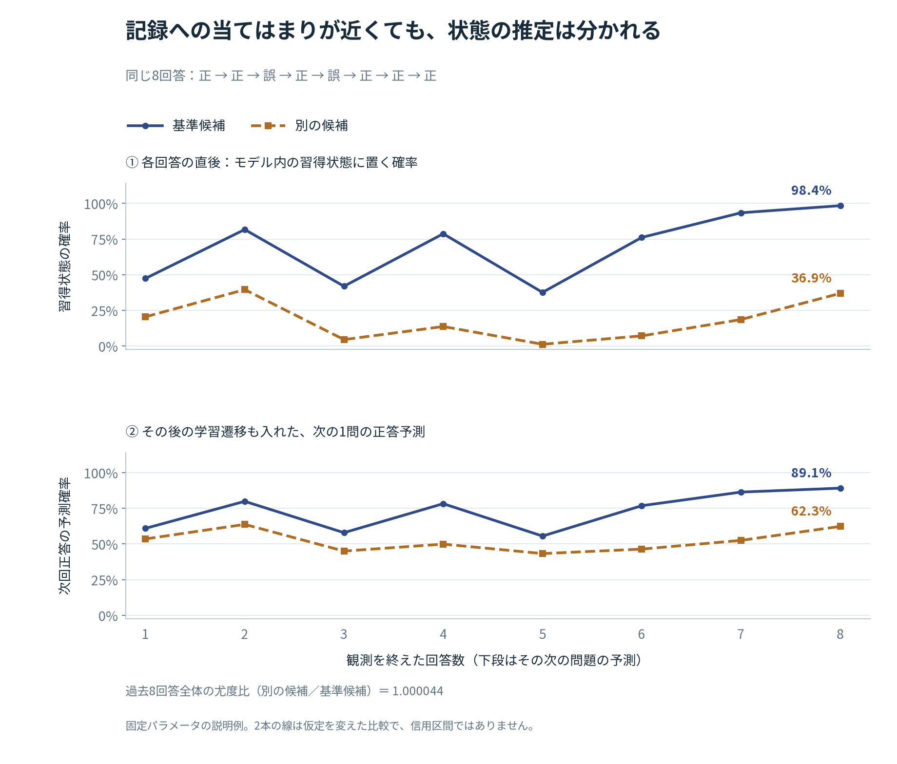

三好の記録から、相手の使い方を考える。

サイコロの仕掛けを直接見なくても、出目と局面を対応させれば、考えられる説明を比べられました。これは、観測できる記録から、直接には見えないものを推定する一つの形です。

ただ、計算で高い確率が出たことと、現実の仕組みを正しく言い当てたことは、同じではありません。

[第6回](https://github.com/okamasaya/underground_ChinChiro_with_baysian/blob/main/articles/chinchiro-bayes-06-false-alarms.md)では、仮説や判定規則を固定したモデルの下で、誤警報の確率を評価しました。シリーズの最後は、そのモデルと現実の間に戻ります。

何が記録から分かり、何が仮定に依存するのか。その区別を付けることが、理解度などの見えない状態を推定し、役立てていくための足場になりそうです。[シリーズ全体の案内は第0回](https://github.com/okamasaya/underground_ChinChiro_with_baysian/blob/main/articles/chinchiro-bayes-00-overview.md)にあります。

## 確率が高いのは、何についてなのか

ここまで計算したのは、「通常賽だけを使う」と「ある戦略で456賽を使う」という、置いた仮説の間での確率でした。

例えば、通常賽にも偏りがある、出目の記録が抜けている、別の仕掛けを使っている、といった説明は、そのままでは候補に入っていません。

候補に入れなかった説明まで含めて、「現実にこの戦略を取っている確率が99%」と確定したわけではないのです。

第6回の誤警報上界も、通常賽の分布や記録の条件が想定どおりであることに依存します。**モデルの中で計算が正しいことと、そのモデルが現実に合っていることを、分けて確かめる必要があります。**

そのためには、例えば、実物の賽を調べる、記録漏れを確認する、新しい対局でも予測が合うかを見る、といった別の観測が役に立ちます。

記録だけで確定しきれないなら、何を追加で見れば説明を区別できるかを考える。推定は、次に調べることを決めるためにも使えます。

## 出目から賽を考えることと、回答から理解を考えること

この構造を、学習の場面へ移してみます。

問題に正解したからといって、必ず理解しているとは限りません。偶然当たったり、同じ問題を覚えていたりすることがあります。反対に、理解していても、読み違いや計算ミスで間違えることはあります。

正誤の記録は観測できます。しかし、その背後にある理解や習得の状態は、直接には見えません。

そこで、観測と状態をつなぐモデルを置き、回答を重ねるごとに状態の推定を更新することを考えます。一つの基本形が、**ベイズ知識追跡（Bayesian Knowledge Tracing; BKT）**です。

基本BKTでは、ある特定のスキルについて、「未習得／習得」という二つの状態を置きます。未習得でも正解する確率、習得していても誤答する確率、回答の間に学習が起こる確率などを使って、正誤から状態を推定します。

ただし、モデルで置いた二値の習得状態が、そのまま人間の理解のすべてを表すわけではありません。

また、地下チンチロでは戦略仮説を固定していましたが、学習では状態そのものが変わり得ます。新しい回答で推定を更新することに加え、次の回答までに状態がどう変わるかも考える必要があります。

## 観測・推定・予測・判断を分けておく

学習の例では、次のように整理できます。

| 層 | 例 | どういうものか |
| --- | --- | --- |
| 観測 | この問題に正解した | 記録された結果 |
| 推定 | このスキルを習得している確率が高い | 記録とモデルから求めた、状態についての見立て |
| 予測 | 次の確認問題に正解する確率が高い | これから観測できる結果への見通し |
| 判断 | 復習を続けるか、次へ進むか | 推定や予測と、判断を誤った場合の影響を踏まえた選択 |

「習得確率98%」は、理解度を100点満点で採点したら98点だった、という意味ではありません。モデルに置いた習得状態に対して、98%の確率を置いているということです。

習得状態の確率と、次の問題に正解する確率も違います。正誤にはミスや偶然正答が混ざり、次の問題までに学習が起こるという仮定も入るためです。

## 同じ8回答でも、状態の推定は分かれる

論文で使った、説明用の正誤列を見てみます。

> 正 → 正 → 誤 → 正 → 誤 → 正 → 正 → 正

実際の学習者から取ったデータではありません。同じスキルの8回答という設定で、二つの固定したパラメータの候補を比べます。

両候補は、偶然正答、習得後の誤答、学習の起こりやすさ、初期の状態について、異なる仮定を置いています。

このとき、過去8回答への当てはまりは、ほとんど同じになりました。ところが、8回答後の状態の推定は大きく分かれます。

| 比べる量 | 基準候補 | 別の候補 |
| --- | ---: | ---: |
| 過去8回答の尤度（基準候補を1とした比） | 1.000000 | 1.000044 |
| 8回答後の習得状態の確率 | 98.4% | 36.9% |
| 次の問題の正答予測 | 89.1% | 62.3% |

ここでいう尤度は、その候補の下で、観測した順番の8回答がどのくらい出やすいかです。候補が正しい確率そのものではありません。

別の候補は、この8回答への当てはまりが基準と近くなる例として選びました。大勢の学習者に当てはめて得た推定値ではありません。

*2本の線は、固定した仮定を変えた比較です。信用区間や誤差帯ではありません。上段は現在の状態の推定、下段はその後の学習遷移も入れた次回の観測予測です。*

数値は分数による更新と、隠れた状態の全経路を列挙する別の計算で照合しています。この差は、計算を粗くしたために出たものではありません。

**一つの有限な記録によく合うことだけでは、その背後の状態の解釈が一つに決まるとは限らない**、という例です。

ただし、どんな記録が増えても永久に区別できないと示したわけではありません。次回の正答予測が違うので、この二つの候補は、将来の記録について異なる予測を持っています。

:::details この例の計算条件

基本BKTの、忘却を含めない設定です。各パラメータは8回答の間で固定しています。

| パラメータ | 意味 | 基準候補 | 別の候補 |
| --- | --- | ---: | ---: |
| $G$ | 未習得でも正解する確率 | 0.250 | 0.415 |
| $S$ | 習得していても誤答する確率 | 0.100 | 0.040 |
| $T$ | 未習得から習得へ移る確率 | 0.150 | 0.020 |
| $q_1$ | 最初の解答前の習得確率 | 0.200 | 0.100 |

表の習得確率は8回答目の正誤を観測した直後、次回正答予測はその後の学習遷移を入れて9問目について計算した値です。

自然対数尤度の差は約$4.432\times10^{-5}$です。尤度が厳密に同じという意味ではなく、表示を丸める前にも、とても近い値となる例です。本文の百分率は小数点以下1桁、尤度比は小数点以下6桁に丸めています。

この2候補を固定した分数計算では、同じデータから各候補の値が一意に求まります。2本の線の間隔を、そのまま推定値の標準誤差や、現実の理解度のずれの大きさとして扱うことはできません。

:::

## 次の観測に、確かめられる問いを置く

見えない状態を推定するときにも、観測できる結果への予測は確かめられます。

例えば、二つの候補を過去8回答で比べたら、その後は候補や評価の方法を固定し、まだ見ていない回答の出やすさを予測します。新しい回答が得られるたび、予測に与えていた確率を使って比べます。

一問当たった候補を正解と決めるのではありません。十分な記録について、予測の外れ方や、観測結果に与えた確率を評価します。

「正答確率80%」と予測した事例を集めたとき、実際の正答割合が80%前後かを見るのが、**較正**の一つの確認方法です。件数の少なさによるばらつきや、問題・学習者による違いにも注意します。

ここで直接確かめているのは、次回の正誤という観測の予測です。予測がよく合っていても、それだけで習得確率が現実の理解度そのものだと確認できたわけではありません。

理解や習得の意味まで検討するなら、例えば、時間を空けた後にも解けるか、別の表現や形式の問題でも使えるか、理由を説明できるか、といった観測を加える方法があります。それぞれの課題の難易度や採点方法も、合わせて確かめます。

**どの観測なら、偶然の正答や同じ問題の記憶と、使える知識とを区別しやすいか。** そこまで考えて、次の記録を設計します。

## 確かめたい対象によって、検証を変える

検証にも、いくつかの段階があります。

| 確かめたいこと | 検証の例 | それだけでは確かめられないこと |
| --- | --- | --- |
| 式どおりに実装できたか | 分数計算と独立な経路列挙を照合する | 現実の学習者にモデルが合うか |
| 仮定した状態を回復できるか | 状態の正解を知っている模擬データで調べる | 実際の理解度を正しく測れるか |
| 将来の回答を予測できるか | 未観測の回答で予測や較正を評価する | 状態の解釈が唯一正しいか |
| 実用上の理解や定着に対応するか | 共通の確認問題、保持・転移課題、外部の評価と比べる | 別の集団や出題条件でも同じ性能か |
| 支援方法を変えると成果が改善するか | 条件をそろえた比較や無作為割付で調べる | 別の学習者・支援方法でも同じ効果か |

今回再計算した8回答の例は、主に最初の実装検証と、仮定を変えた比較です。論文の将来回答の模擬実験も、モデルが作る観測予測を比べたもので、実際の学生の理解度を検証した結果ではありません。

記録を増やすときには、問題の種類、出題の順番、解説の有無、回答までの時間、どんな方針でその問題を選んだかも残しておきたいところです。三好の記録で、出目と局面を対応させたこととつながります。

ただし、情報を増やせば必ず推定がよくなるわけでもありません。例えば、自信度を答えない人の値を0として扱えば、「自信がない」と「未入力」が混ざります。追加した情報の意味や欠測も、モデルと評価に含める必要があります。

## 推定を、支援へつなげる可能性

見えない状態を確定できなくても、複数の説明を残したまま、次の確認や支援を考えることはできます。

例えば、モデルによって「習得している」という見立てが大きく変わるなら、その数値だけで復習を終えず、別形式の確認問題を出す。次回の誤答が予測される条件では、教師の確認につなぐ。どのような判断が役立つかを、将来の課題で評価していく使い方です。

ここで、「解説を読んだ後に習得確率が上がった」と「その解説によって学習成果が改善した」も区別します。前者はモデルの計算結果、後者は支援の因果効果についての問いです。

支援の効果を調べるには、解説の候補を比較できるようにし、共通の将来課題で成果を見るなど、別の検証が要ります。推定値そのものの上昇だけを、支援が成功した証拠にはしません。

学習以外でも、機械の測定記録から故障の兆候を考えたり、LLMの回答を外部の正誤記録と照らしてレビューへ回す条件を考えたりする方向があり得ます。共通するのは、**観測と見えない対象をどうつなぎ、予測と判断を何で評価するかを決めること**です。使う尤度や検証データは、対象ごとに用意し直します。

これらは応用の見通しであり、この連載の計算だけで、教育や品質管理での有効性を実証したわけではありません。

## 三好が残し、カイジが読み直した記録から

このシリーズは、「よく勝つ相手」の記録を、どう見直せるかという問いから始まりました。

単一の出目から仮説を更新し、通常賽を混ぜる使い方、3個一式と振り直し、勝敗、勝負どころへと、条件を増やしてきました。そのたびに、同じ記録でも、比較する説明によって証拠の意味が変わりました。

三好の役割を情報を残すこと、カイジの着眼点を比較する仮説を考えることとして捉えたのは、その二つがそろって初めて、記録を読み直せるからです。そこから先は、考えた説明が次の観測にも通用するかを確かめます。

見えないものについても、観測との関係を明示すれば、不確かさを含めて考えを更新できます。さらに、説明を区別するために何を観測すればよいか、推定を使った判断が役立ったかへ、問いを進められます。

地下チンチロから考え始めたことは、そうした推定と検証の往復にもつながりそうです。

## 詳しい資料・コード

- **[今回の図を再生成するPythonコード](https://github.com/okamasaya/underground_ChinChiro_with_baysian/blob/main/articles/assets/plot_chinchiro_validation.py)**
  二つの固定候補について、正誤列の尤度、各回答後の状態確率、次回正答予測を分数で計算して作図します。
- **[BKTの厳密計算・独立照合・将来比較のコード](https://github.com/okamasaya/underground_ChinChiro_with_baysian/blob/main/analysis/bkt_sequential_validation.py)**
  `exact_filter()`が更新計算、`hidden_enumeration()`が隠れた状態経路の独立列挙です。今回の8回答の作図では、大規模な将来回答の模擬実験は実行しません。
- **[Full paper：モデル・導出・検証の詳細](https://github.com/okamasaya/underground_ChinChiro_with_baysian/blob/main/kaiji_ungr_456dice.pdf)**
  第13〜16節で、地下チンチロとの対応、BKTの有限標本の例、不確かさと検証計画を扱います。図A22が今回の2候補に対応し、第17〜20節では予測の監視、応用案、支援の因果効果へ進みます。
- **[Letter：主要結果をまとめた4ページの資料](https://github.com/okamasaya/underground_ChinChiro_with_baysian/blob/main/kaiji_bayes_letter_20261105.pdf)**
  賽の戦略仮説の推定から、潜在状態の推定と検証へつなぐ全体像を確認できます。
- **[GitHubリポジトリ](https://github.com/okamasaya/underground_ChinChiro_with_baysian)**
  図版と保存データ、[再現手順](https://github.com/okamasaya/underground_ChinChiro_with_baysian/blob/main/docs/REPRODUCIBILITY.md)を収録しています。

物語の着想は、福本伸行『賭博破戒録カイジ』の地下チンチロ編によります。本文のモデルと説明用の回答列は、原作の実対局、登場人物の心理、実際の学習者の理解を数値的に再現したものではありません。
